<div align="center">

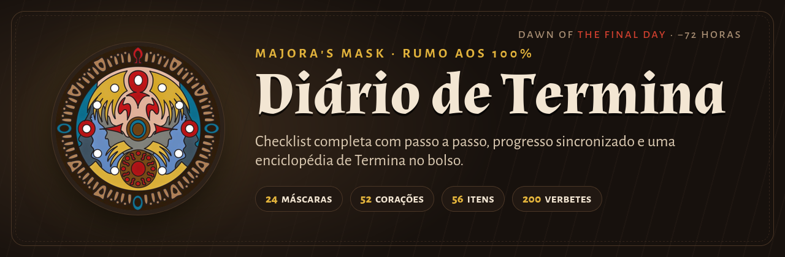

<br>

[](https://diario-de-termina.web.app)


<br>

*"Você encontrou um destino terrível, não foi?"*

</div>

---

## 🌙 Sobre

O **Diário de Termina** é um companheiro de bolso para fechar **The Legend of Zelda: Majora's Mask** (versão N64) em **100%**. Ele reúne num só lugar tudo o que normalmente fica espalhado em cinco abas de guia abertas no celular: as 24 máscaras na ordem recomendada, os 52 pedaços de coração, o inventário completo, as canções e uma enciclopédia de Termina com 200 verbetes.

Cada máscara e item tem uma página própria com screenshot, requisitos e passo a passo. Você marca o que já pegou e o progresso fica salvo, inclusive entre o celular e o computador quando se entra com a conta Google.

<table>
<tr>
<td align="center" width="25%"><h3>24</h3>máscaras em 6 fases</td>
<td align="center" width="25%"><h3>52</h3>pedaços de coração<br><sub>+ 4 Heart Containers</sub></td>
<td align="center" width="25%"><h3>56</h3>itens, frascos<br>e canções</td>
<td align="center" width="25%"><h3>200</h3>verbetes na<br>enciclopédia</td>
</tr>
</table>

## 🎭 Telas

<table>
<tr>
<td align="center">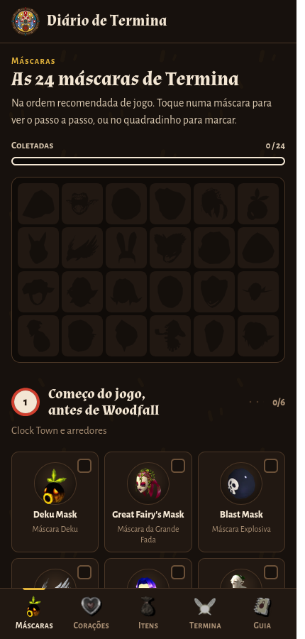<br><b>Máscaras</b><br><sub>Tela de máscaras do jogo e fases em ordem</sub></td>
<td align="center">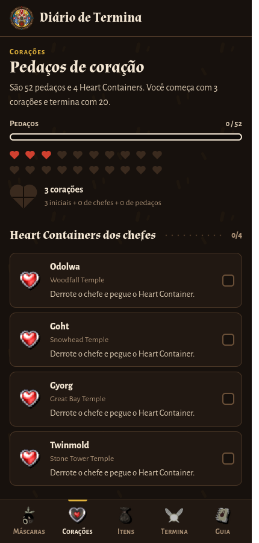<br><b>Corações</b><br><sub>Pedaços em quartos, como no HUD do jogo</sub></td>
<td align="center">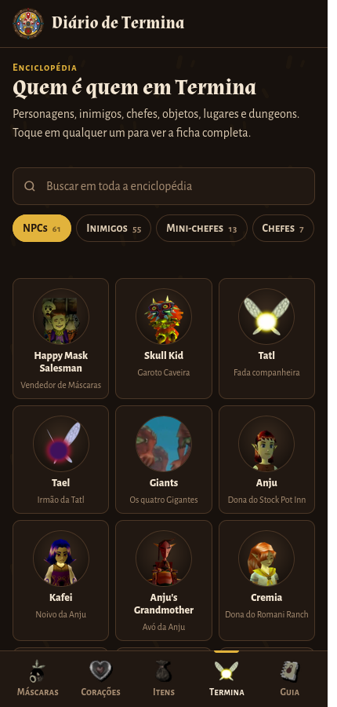<br><b>Termina</b><br><sub>Quem é quem: NPCs, inimigos e chefes</sub></td>
</tr>
<tr>
<td align="center">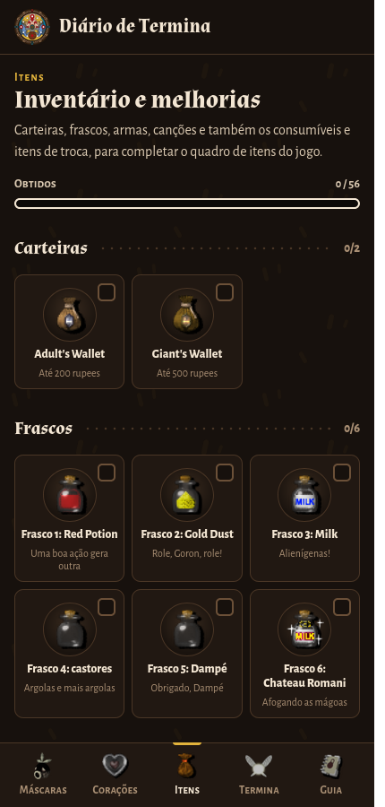<br><b>Itens</b><br><sub>Ícones originais do inventário</sub></td>
<td align="center">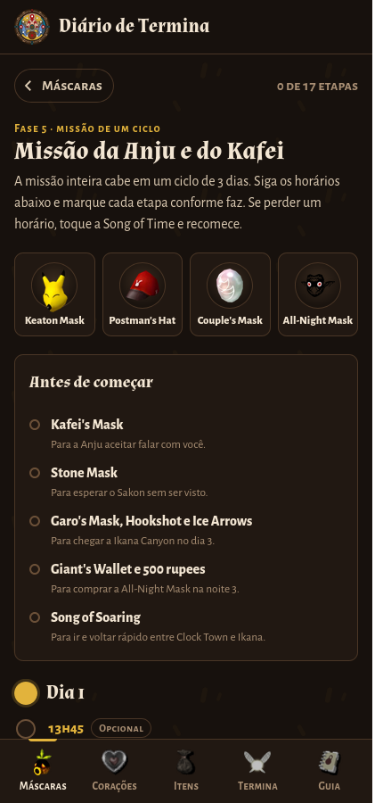<br><b>Anju &amp; Kafei</b><br><sub>A missão inteira, hora a hora, em um ciclo</sub></td>
<td align="center">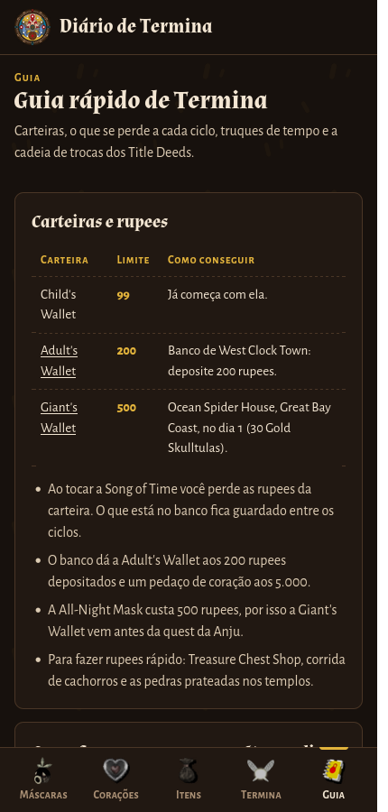<br><b>Guia</b><br><sub>Truques de tempo, rupees e Title Deeds</sub></td>
</tr>
<tr>
<td align="center">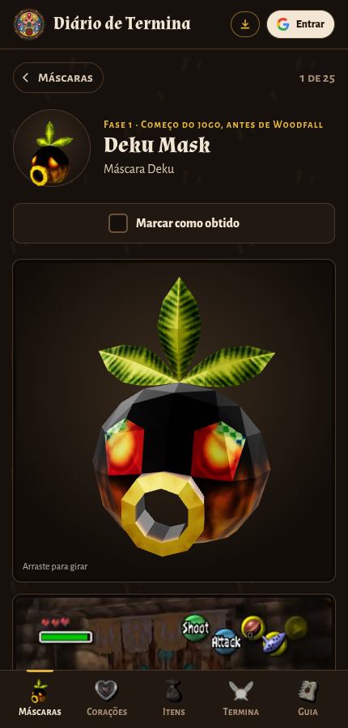<br><b>Modelo 3D</b><br><sub>Cada máscara gira e pode ser arrastada</sub></td>
<td align="center">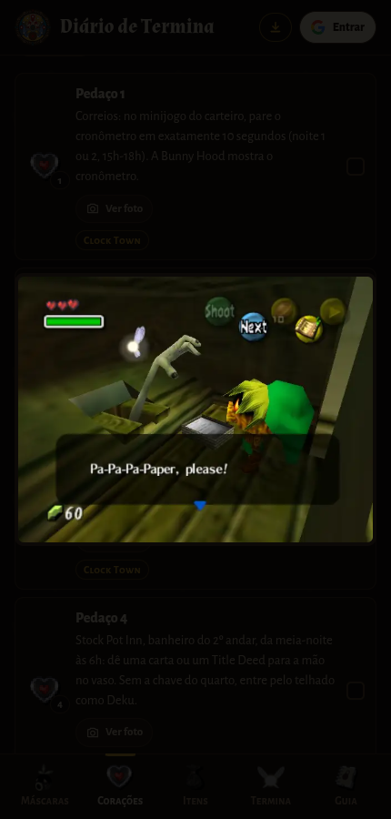<br><b>Onde achar</b><br><sub>Foto do local de cada pedaço de coração</sub></td>
<td></td>
</tr>
</table>

<details>
<summary><b>🖥️ Versão desktop</b></summary>
<br>
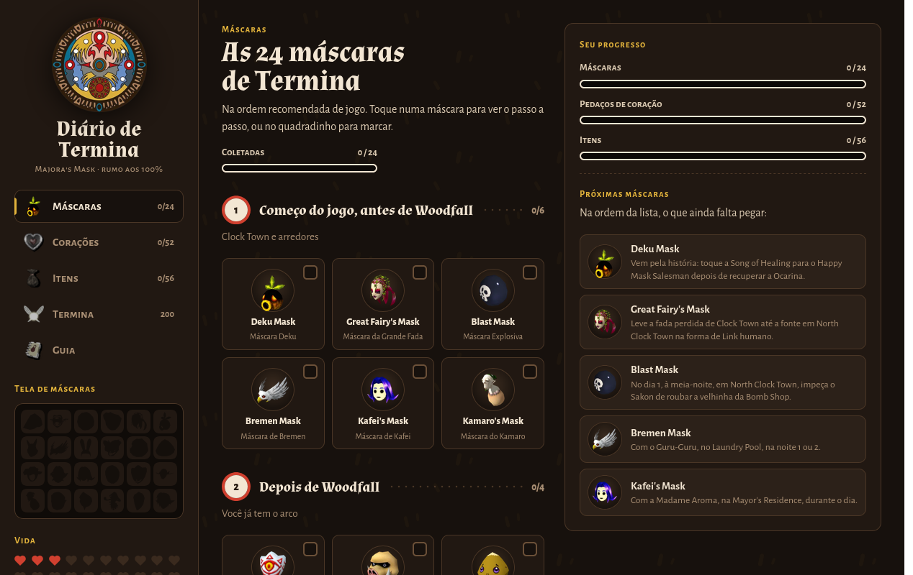
<p><sub>No computador, a barra lateral mostra a tela de máscaras e a vida em corações, e o painel da direita sugere as próximas máscaras a pegar.</sub></p>
</details>

## ✨ Recursos

| | |
|---|---|
| 🎭 **Máscaras em ordem de jogo** | As 24 máscaras divididas em 6 fases (do começo até o Fierce Deity), com uma réplica da tela de máscaras do jogo que vai se preenchendo. Cada máscara tem um modelo 3D que gira e pode ser arrastado na visualização detalhada. |
| ❤️ **Corações como no jogo** | Os 52 pedaços agrupados por região e os 4 Heart Containers dos chefes. A contagem mostra quartos de coração e a vida total (3 iniciais → 20). 48 dos 52 pedaços têm uma foto de onde achar, aberta pelo botão "Ver foto". |
| 🎒 **Inventário completo** | 10 grupos: carteiras, frascos, bolsas de bomba, arco e aljavas, espadas e escudos, Grandes Fadas, itens importantes, consumíveis, itens de troca e as 13 canções. |
| 📜 **Missão da Anju e do Kafei** | A quest mais longa do jogo em 17 etapas com horário, do dia 1 à noite 3, com pré-requisitos e o que fazer depois. |
| 📖 **Enciclopédia de Termina** | 61 NPCs, 55 inimigos, 13 mini-chefes, 7 chefes, 20 objetos, 33 locais e 11 dungeons, com busca, fichas ligadas entre si e dicas de combate. |
| 🕰️ **Guia rápido** | Carteiras e rupees, o que fica e o que some ao voltar ao dia 1, truques com as Songs of Time e a cadeia dos Title Deeds. |
| ☁️ **Sincronização** | Login com Google e progresso salvo no Firestore, igual em qualquer aparelho. Sem login, tudo fica no próprio navegador. |
| 📱 **PWA** | Instalável na tela inicial com ícone próprio e funciona offline (rede primeiro, cache como reserva). |

## 🎨 Identidade visual

O visual foi pensado como um diário encontrado em Clock Town: madeira escura, pergaminho e o ouro do relógio, com a chuva da noite caindo ao fundo.

| Token | Cor | Uso |
|---|---|---|
| `--ground` |  | fundo da página |
| `--panel` |  | cartões e painéis |
| `--ink` |  | texto principal |
| `--gold` |  | destaques e rótulos |
| `--red` |  | corações e alertas |
| `--magic` |  | itens concluídos |
| `--sky` |  | links e informação |

Tipografia: **Almendra** nos títulos, **Alegreya Sans** no texto e **Alegreya Sans SC** nos rótulos em versalete.

## 🏗️ Como funciona

O site é uma única página estática, sem framework nem bundler. Um script Python junta o template e os arquivos de dados em `public/index.html`, que é publicado no Firebase Hosting.

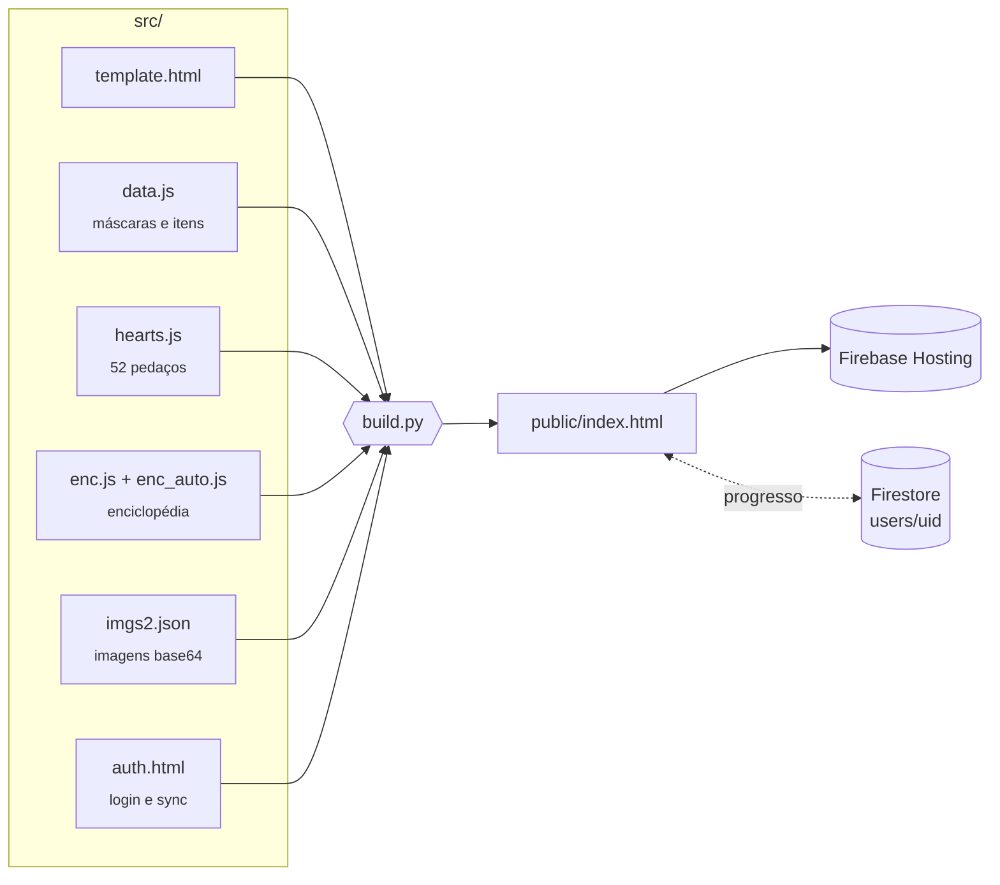

### Estrutura

```
diario-de-termina/
├── src/
│   ├── template.html     página: HTML, CSS e lógica da checklist
│   ├── data.js           fases das máscaras, grupos de itens e a missão da Anju
│   ├── hearts.js         os 52 pedaços de coração
│   ├── enc.js            NPCs, objetos, locais e dungeons (texto próprio)
│   ├── enc_auto.js       inimigos, mini-chefes e chefes (gerado)
│   ├── imgs2.json        imagens embutidas (base64)
│   ├── auth.html         login com Google e sincronização com o Firestore
│   └── icons/            ícones originais do inventário
├── tools/
│   ├── enc_src.json      texto de inimigos e chefes extraído dos guias do Hyrule Legends
│   ├── enc_auto.py       gera src/enc_auto.js a partir de enc_src.json
│   ├── enc_check.js      valida ids e referências e lista as imagens
│   ├── enc_fetch.py      baixa e converte as imagens para public/enc/<id>.webp
│   ├── hearts_images.json qual figura do detonado vai em cada pedaço de coração
│   ├── hearts_fetch.py   baixa e converte as fotos para public/coracoes/h<n>.webp
│   └── modelos/          scripts que convertem os modelos das máscaras (OBJ/DAE) para GLB
├── public/               site publicado (index.html, sw.js, manifest, ícones, enc/, coracoes/, modelos/)
├── docs/                 banner e capturas deste README
├── build.py              monta public/index.html
├── firebase.json         hosting com no-cache no HTML, no SW e no manifest
└── firestore.rules       cada usuário só acessa o próprio documento
```

### Segurança dos dados

Cada pessoa só lê e grava o próprio documento `users/{uid}`. As regras do Firestore também limitam o formato: apenas os campos `state` e `updatedAt`, com no máximo 200 entradas no estado.

## 🛠️ Desenvolvimento

Requisitos: Python 3 e Node.js (só para as ferramentas e o deploy).

```bash
# 1. monta a página a partir de src/
python3 build.py

# 2. testa localmente em http://localhost:5000
python3 -m http.server 5000 -d public

# 3. publica site e regras
npx firebase-tools deploy --only hosting,firestore:rules
```

### Enciclopédia

```bash
python3 tools/enc_auto.py        # regenera inimigos e chefes a partir de enc_src.json
node tools/enc_check.js .        # confere ids, referências cruzadas e imagens
python3 tools/enc_fetch.py /tmp/enc-cache   # baixa e converte as imagens para public/enc/
```

### Fotos dos corações

```bash
python3 tools/hearts_fetch.py /tmp/hearts-cache   # baixa só as que faltam em public/coracoes/
```

Para trocar uma foto, edite `tools/hearts_images.json`, apague a imagem antiga em `public/coracoes/` e rode o script de novo.

### Modelos 3D das máscaras

Os arquivos `public/modelos/<id>.glb` vêm dos modelos de *Majora's Mask 3D* do The Models Resource, convertidos com `trimesh` e `pycollada` (`pip install trimesh pycollada pillow`). A página mostra com o [`<model-viewer>`](https://modelviewer.dev), carregado só quando uma máscara é aberta.

- `tools/modelos/conv.py`: converte os OBJ (a maioria)
- `tools/modelos/zup.py`: endireita os DAE que vêm com Z para cima
- `tools/modelos/bunny.py`: Bunny Hood, que precisa de leitura manual do DAE
- `tools/modelos/flatten.py`: Blast Mask e Couple's Mask, juntando as duas camadas de textura numa só

> [!TIP]
> Ao mudar arquivos do site, aumente a versão de `CACHE` em `public/sw.js` para que quem instalou o app receba a atualização.

## 🗺️ Créditos

- Imagens das máscaras, frascos e canções e informações de apoio: [Hyrule Legends](https://zelda.com.br/mm)
- Ícones de itens do inventário: [Zelda Wiki](https://zeldawiki.wiki)
- Lista de pedaços de coração baseada no guia do [Thonky](https://www.thonky.com/zelda-majoras-mask/pieces-of-heart)
- Fotos de onde achar os pedaços de coração: figuras do [detonado do Hyrule Legends](https://zelda.com.br/mm/detonado/pagina-01)
- Modelos 3D das máscaras: [The Models Resource](https://www.models-resource.com) (*Majora's Mask 3D*, extraídos por Guy)
- Ícone do relógio de Clock Town: arte de Otaku Crafts

<div align="center">
<br>
<sub>Projeto de fã, sem fins lucrativos. <i>The Legend of Zelda</i> e <i>Majora's Mask</i> são marcas da Nintendo.</sub>
<br><br>
<b>🌕 Faltam 72 horas. Boa sorte, herói.</b>
</div>
